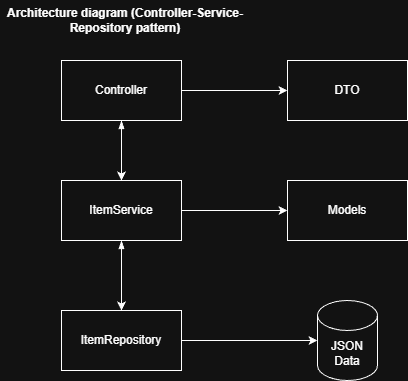

# Meli Challenge Backend

## Description

Challenge for Backend Developer in Go with Gin.

## Setup

1. Install go 1.23 or higher and Gin framework.
2. Clone the repository.
3. Navigate to the project directory.
4. Run `go mod tidy` to install dependencies.
5. Start the server with `go run main.go`.
The server will run on `http://localhost:8080`.

## Example usage

With `curl`:

- Get item by ID:

```bash
curl http://localhost:8080/items/1
```

- Get all items:

```bash
curl http://localhost:8080/items
```

- Add a new item:

```bash
curl -X POST http://localhost:8080/items \
    -H "Content-Type: application/json" \
    -d '{
        "product_name": "Sample Product",
        "image_url": "http://example.com/image.jpg",
        "description": "This is a sample product.",
        "price": 99.99,
        "rating": 4.5,
        "specifications": {
            "color": "red",
            "size": "M"
        }
    }'
```

- Compare items:

```bash
curl -X POST http://localhost:8080/items/compare \
    -H "Content-Type: application/json" \
    -d '{
        "ids": ["1", "2", "3"]
    }'
```

## Endpoints

- `GET /items/:id` - Get item by product ID.
  Path Parameters:
  - id: Product ID of the item.

- `GET /items` - Get all items.

- `POST /items` - Add a new item.
  Body Parameters:
  - product_name: Name of the product (required).
  - image_url: URL of the product image.
  - description: Description of the product.
  - price: Price of the product (required, greater than 0).
  - rating: Rating of the product (between 0 and 5).
  - specifications: Specifications of the product as key-value pairs.

- `POST /items/compare` - Compare items by product IDs.
  Body Parameters:
  - ids: List of product IDs to compare.

## Tests

Run tests in item_test.go

```bash
go test -v ./test/item_test.go
```

## Architecture

Layered architecture with Controller, Service, Repository, DTO and Models layers.

## Diagram


